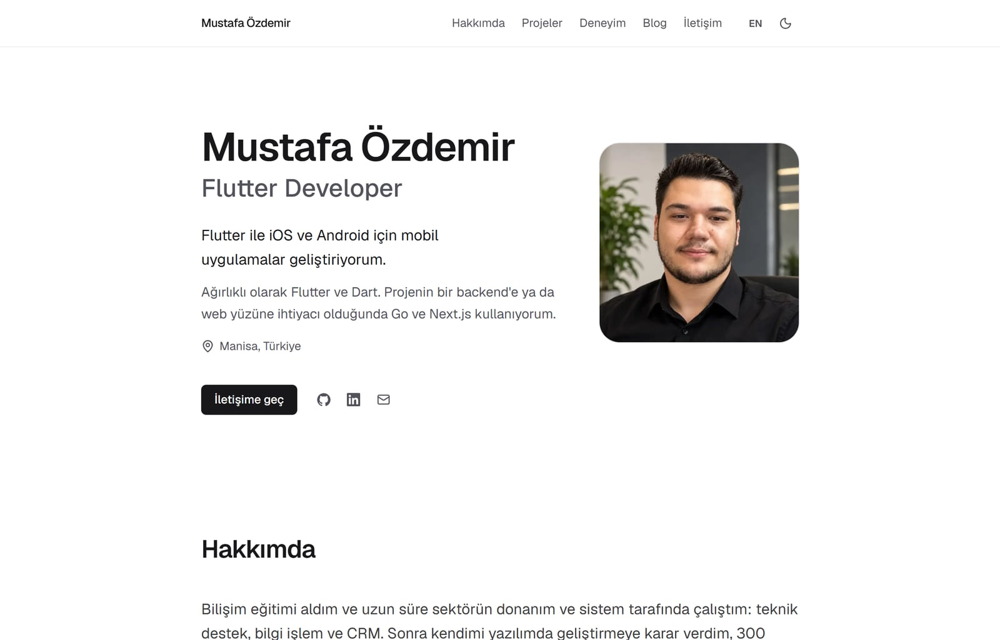

# ozdemirmustafa.com

Kişisel sitem. Ne iş yaptığımı, üzerinde çalıştığım projeleri ve ara sıra yazdığım yazıları burada topluyorum. Site Türkçe ve İngilizce.



## Neler kullandım

- Next.js 16 ve TypeScript
- Tailwind CSS
- Blog yazıları için MDX
- İletişim formu için Nodemailer
- Yayında: kendi sunucumda Node.js + Nginx, önünde Cloudflare

## Kendi bilgisayarında çalıştırmak

```bash
npm install
cp .env.example .env.local
npm run dev
```

Sonra http://localhost:3000 adresini aç. `.env.local` dosyasını boş bıraksan da site açılır, sadece iletişim formu mail gönderemez.

## İçerik nerede

Sitedeki bilgilerin çoğu koddan ayrı dosyalarda duruyor, bir şeyi güncellemek için bileşenlere dokunmak gerekmiyor:

- `src/content/`: profil, projeler, deneyim, eğitim ve yetenekler
- `src/content/blog/tr` ve `src/content/blog/en`: blog yazıları
- `src/i18n/dictionaries/`: arayüzdeki metinler

Yeni bir yazı eklemek için iki klasöre de aynı isimle bir `.mdx` dosyası koymak yeterli.

## Ortam değişkenleri

`.env.example` dosyasında hepsi var. Kısaca:

- `NEXT_PUBLIC_SITE_URL`: sitenin adresi, sitemap ve paylaşım önizlemeleri bunu kullanıyor
- `NEXT_PUBLIC_TURNSTILE_SITE_KEY`, `TURNSTILE_SECRET_KEY`: formdaki Cloudflare Turnstile doğrulaması. Site anahtarı build sırasında sayfaya gömüldüğü için değiştirirsen yeniden build almak gerekiyor.
- `SMTP_HOST`, `SMTP_PORT`, `SMTP_SECURE`: mail sunucusu. 465 portunda `SMTP_SECURE=true` (implicit TLS).
- `SMTP_TLS_SERVERNAME`: mail sunucusuna IP ile bağlanılıyorsa sertifikadaki alan adı. Sertifika doğrulaması açık kalıyor, sadece hangi isme göre doğrulanacağını söylüyor.
- `SMTP_USER`, `SMTP_PASSWORD`: formun gönderdiği hesap
- `MAIL_FROM`: gönderen adres. Yanıtla dendiğinde ziyaretçinin adresine gidiyor.
- `MAIL_TO`: mesajların düşeceği adres
- `GITHUB_TOKEN`: zorunlu değil. Verirsen katkı takvimi GitHub API'sinden gelir, vermezsen herkese açık profil sayfasından okunur.

Lokal geliştirmede formu denemek için Cloudflare'in [test anahtarları](https://developers.cloudflare.com/turnstile/troubleshooting/testing/) kullanılabilir.

## Yayına alma

Site sunucuda bir systemd kullanıcı servisi olarak çalışıyor, Node.js de kullanıcı klasörüne kurulu. `sudo` sadece ilk kurulumda ve Nginx ayarında gerekiyor.

İlk kurulum:

```bash
sudo loginctl enable-linger $USER
git clone https://github.com/ozdemirmustafadev/portfolio.git ~/portfolio
~/portfolio/deploy/setup.sh
```

`setup.sh` ilk çalıştığında Node.js'i `~/.local/node` altına kuruyor, servisi tanımlıyor ve `.env` dosyasını sadece senin okuyabileceğin şekilde (`600`) oluşturup duruyor. `.env` doldurulduktan sonra aynı script tekrar çalıştırılınca build alıp siteyi başlatıyor. Build öncesi boştaki RAM 1.5 GB'tan azsa uyarıp onay istiyor.

Uygulama sadece `127.0.0.1:3000` portunu dinliyor, dışarıya Nginx açıyor. `deploy/nginx.conf` içinde Cloudflare IP aralıkları için gerçek IP ayarı, statik dosyalar için uzun süreli önbellek ve Certbot'un SSL satırları var:

```bash
sudo cp ~/portfolio/deploy/nginx.conf /etc/nginx/sites-available/mustafa
sudo nginx -t && sudo systemctl reload nginx
```

Cloudflare IP aralıkları zamanla değişebilir, güncel liste [cloudflare.com/ips](https://www.cloudflare.com/ips/) adresinde.

Güncellemek için:

```bash
~/portfolio/deploy/deploy.sh
```

Logları görmek için `journalctl --user -u portfolio -f`.

### Repo gizliyse

Sunucunun repoyu çekebilmesi için sadece bu repoya, salt okunur erişimi olan ayrı bir deploy key kullanıyorum. Kişisel SSH anahtarı sunucuya konmuyor.

Sunucuda anahtarı oluştur:

```bash
ssh-keygen -t ed25519 -f ~/.ssh/portfolio_deploy -C "portfolio deploy key" -N ""
cat ~/.ssh/portfolio_deploy.pub
```

Çıkan satırı GitHub'da repo → **Settings** → **Deploy keys** → **Add deploy key** kısmına yapıştır. **Allow write access** kutusunu işaretleme.

Sonra `~/.ssh/config` dosyasına şunu ekle:

```
Host github-portfolio
    HostName github.com
    User git
    IdentityFile ~/.ssh/portfolio_deploy
    IdentitiesOnly yes
```

Repoyu bu adla klonla:

```bash
git clone git@github-portfolio:ozdemirmustafadev/portfolio.git ~/portfolio
```

Repo zaten HTTPS ile klonlandıysa adresi değiştirmek yeterli:

```bash
git -C ~/portfolio remote set-url origin git@github-portfolio:ozdemirmustafadev/portfolio.git
```

---

Kodu inceleyip fikir almakta serbestsin. Yazılar ve fotoğraflar bana ait.
